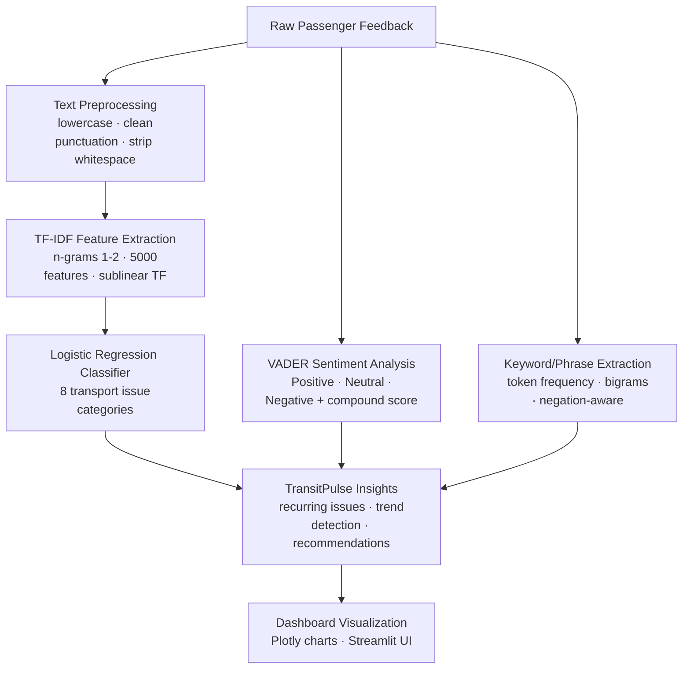

# TransitVoice 🚌

**AI-Powered Public Transport Feedback Analyzer**

> ⚠️ This project uses **synthetic/illustrative data** only — not real passenger submissions or real transport authority data.

---

## Problem Statement

Public transport services receive thousands of pieces of passenger feedback. Manually reviewing these is time-consuming, and recurring problems — delays, cleanliness issues, accessibility gaps — can go undetected. TransitVoice uses NLP to automatically classify complaints, identify sentiment, and surface recurring issues in an interactive dashboard.

---

## Key Features

| Feature | Description |
|---|---|
| **Live Feedback Analyzer** | Enter any feedback text and get instant classification, sentiment score, and keyword extraction |
| **TransitPulse** ⭐ | Detects recurring issues, visualizes negative feedback trends, and generates rule-based recommendations |
| **Route & Service Insights** | Filter feedback by route, category, and sentiment to compare service performance |
| **CSV Export** | Download filtered, analyzed feedback as a CSV file |
| **Overview Dashboard** | KPI cards, sentiment donut chart, category bar chart, and recent feedback table |

---

## NLP Pipeline



**Pipeline explained (beginner-friendly):**

1. **Text Preprocessing** — The raw text is converted to lowercase, extra spaces and punctuation are removed, but apostrophes are kept so negations like "not clean" or "can't board" are preserved.

2. **TF-IDF Feature Extraction** — TF-IDF (Term Frequency–Inverse Document Frequency) converts text into numbers. Words that appear often in one feedback record but rarely across all records get a higher score, making them useful signals.

3. **Logistic Regression Classification** — A trained Logistic Regression model uses these TF-IDF scores to classify feedback into one of 8 transport issue categories. The model was trained on labeled example data with an 80/20 train/test split.

4. **VADER Sentiment Analysis** — VADER (Valence Aware Dictionary for sEntiment Reasoning) is a rule-based model specifically designed for social text. It assigns a compound score from −1 (most negative) to +1 (most positive). It runs on the **original** (un-preprocessed) text to preserve negations.

5. **Keyword Extraction** — Token frequencies and bigrams are used to extract the most meaningful words from the input text, ignoring common stopwords.

6. **TransitPulse** — Aggregates classification and sentiment results across all feedback records to identify the most frequently reported issues, recurring keywords in negative feedback, and route-level patterns.

---

## Technology Stack

| Library | Purpose |
|---|---|
| **Streamlit** | Frontend web application and interactive UI |
| **pandas** | Data loading, filtering, and tabular operations |
| **scikit-learn** | TF-IDF vectorizer, Logistic Regression classifier, train/test split |
| **vaderSentiment** | Rule-based sentiment analysis |
| **Plotly** | Interactive bar charts, pie/donut charts |
| **joblib** | Saving and loading the trained model pipeline |

---

## Dataset

- **Records:** 160 synthetic feedback entries (20 per category × 8 categories)
- **Categories:** Delays and Punctuality, Overcrowding, Cleanliness, Staff Behaviour, Ticketing and Fares, Safety and Security, Accessibility, Other Issues
- **Routes:** Route 12A, Route 7B, Route 5C, Route 9, Route 14, Route 18, Route 22, Route 33, Metro Line 1, Metro Line 2, Metro Line 3, Central Station
- **Limitation:** The dataset is synthetic and intentionally small. It is sufficient for a prototype classifier but not for production-level accuracy claims. The model's confidence scores are indicative, not guarantees of correctness.

---

## Model Training and Evaluation

- **Algorithm:** Logistic Regression with balanced class weights
- **Features:** TF-IDF with 1–2 grams, 5000 max features, sublinear TF scaling
- **Split:** 80% training / 20% testing with stratification and fixed random seed (42)
- **Model persistence:** Saved to `models/transit_classifier.joblib` after first training; reloaded on subsequent runs

The model is automatically retrained if the saved file does not exist. You can force a retrain from the sidebar "🔄 Retrain Model" button.

---

## Installation

```bash
# 1. Clone or copy the project folder
cd path/to/NLP_Proj

# 2. Install dependencies
pip install -r requirements.txt
```

---

## How to Run

```bash
# From the project directory:
streamlit run app.py
```

Open your browser at: **http://localhost:8501**

The dataset (`data/passenger_feedback.csv`) and trained model (`models/transit_classifier.joblib`) are created automatically on first run.

---

## Example Inputs and Outputs

| Input | Predicted Category | Sentiment |
|---|---|---|
| "The bus was 25 minutes late and no announcement was made." | Delays and Punctuality | Negative |
| "Staff were incredibly helpful and friendly today." | Staff Behaviour | Positive |
| "Lift at the station is broken again." | Accessibility | Negative |
| "The bus was quite full but I managed to get a seat." | Overcrowding | Neutral |
| "I was charged twice for one journey." | Ticketing and Fares | Negative |

---

## Screenshots

To add screenshots to this README:
1. Run the app and navigate to each page.
2. Press `PrtSc` or use a snipping tool to capture the screen.
3. Save images to an `assets/screenshots/` folder.
4. Add them here:

```


```

---

## Current Limitations

- Dataset is synthetic; real-world accuracy will differ.
- Classifier confidence scores are prototype-level indicators only.
- Trend detection requires at least two weeks of dated data to be meaningful.
- No real transport authority integration or live GPS data.
- Session-added feedback is not persisted after the browser tab is closed.

## Future Enhancements

- Connect to real open transport feedback APIs (where publicly available).
- Add BERT or DistilBERT fine-tuned on transport text for improved classification accuracy.
- Persistent storage with SQLite or PostgreSQL.
- Automated daily reports and email summaries.
- Multi-language feedback support.
- Geocoded route mapping with interactive maps.
