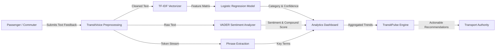

# PIMPRI CHINCHWAD EDUCATION TRUST’S
# PIMPRI CHINCHWAD COLLEGE OF ENGINEERING

---

<br><br><br>

# A REPORT ON
## **“TransitVoice: AI-Powered Public Transport Feedback Analyzer”**

<br>

*Submitted in partial fulfillment of the requirements for*

### **Mini Project of**
### **TYBTech Course: Natural Language Processing Lab**

<br><br>

*Submitted by*
### **Tanvi Jadhav - 124B1C111**

**Academic Year 2026-27 Semester-I**

<br><br>

*Under the support and guidance of*
### **Dr. Sonal Gore & Mrs. Yogita Sharma**
**Department of Computer Science & Engineering (AI&ML)**

<br><br>

---
<!-- PAGE BREAK (PAGE 1 TO PAGE 2) -->
<div style="page-break-after: always;"></div>

## 1. Aim or Project Title
**TransitVoice: AI-Powered Public Transport Feedback Analyzer**

## 2. Detailed Problem Statement
Public transport networks handle thousands of passenger journeys daily. Passengers routinely encounter challenges such as route delays, bus/metro overcrowding, poor cleanliness, ticketing irregularities, accessibility limitations, and security hazards. While transport authorities collect user grievances through web portals, complaint forms, and social media, manually reviewing, tagging, and prioritizing unstructured textual feedback is labor-intensive and error-prone. Critical recurring patterns remain unnoticed until passenger dissatisfaction escalates. A dedicated system is required to automatically parse free-form comments, categorize grievances, quantify sentiment polarity, and highlight chronic route-level issues.

## 3. Objectives
- Automatically clean and preprocess free-form textual feedback while preserving negation context (e.g., "not clean", "can't board").
- Extract weighted textual feature vectors using Sublinear TF-IDF (Term Frequency–Inverse Document Frequency) unigrams and bigrams.
- Classify feedback across 8 transport domains using a multi-class Logistic Regression classifier.
- Quantify passenger sentiment and valence compound scores using rule-based VADER sentiment analysis.
- Extract high-frequency key terms and salient bigrams for rapid complaint summarization.
- Implement **TransitPulse**, an automated recurring issue detection and rule-based recommendation module.
- Deliver an interactive, filterable web dashboard with route-level analytics and CSV export capability.

## 4. Scope of Project
- **In Scope:** Classification of multi-domain feedback into 8 transport categories; separate sentiment analysis; recurring complaint discovery; route-wise analytics; interactive Streamlit interface; local model inference without cloud APIs.
- **Out of Scope:** Live GPS/telematics tracking, direct database integration with transport authority ERPs, speech-to-text processing, or large-scale generative LLM inference.

## 5. Need of Such System
- Eliminates manual review bottlenecks in customer grievance departments.
- Provides quantitative metrics (sentiment polarity and confidence indicators) from subjective comments.
- Pinpoints root operational causes on specific routes or stations before major escalations.
- Enables data-backed resource allocation (e.g., deploying additional buses during peak overcrowding hours).

## 6. Intended User
- Municipal Transport Authorities (Bus & Metro Corporation Operations Teams).
- Customer Grievance & Quality Assurance Officers.
- Route & Fleet Scheduling Managers.
- Commuters evaluating route performance and service reliability.

## 7. Application Domain of User
- Intelligent Transportation Systems (ITS).
- Public Sector Service Operations & Grievance Redressal.
- Applied Natural Language Processing & Customer Sentiment Analytics.

---
<!-- PAGE BREAK (PAGE 2 TO PAGE 3) -->
<div style="page-break-after: always;"></div>

## 8. Software Requirement
- **Operating System:** Windows 10/11, Linux, or macOS
- **Programming Language:** Python 3.10 or newer
- **Web UI & Dashboard:** Streamlit
- **Machine Learning & NLP:** scikit-learn, VADER Sentiment (`vaderSentiment`), pandas, NumPy
- **Visualization:** Plotly Express & Plotly Graph Objects
- **Model Serialization:** Joblib

## 9. Hardware Requirement
- **Processor:** Intel Core i3 / AMD Ryzen 3 or higher (dual-core 2.0 GHz minimum)
- **RAM:** 4 GB minimum (8 GB recommended)
- **Storage:** 500 MB available local disk space
- **Display Resolution:** 1280 x 720 minimum for dashboard viewing

## 10. Architecture Diagram

```mermaid
flowchart TD
    subgraph UI_Layer["User Interface & Presentation Layer (Streamlit)"]
        A1[Live Feedback Input]
        A2[Overview Dashboard]
        A3[TransitPulse Dashboard]
        A4[Route Analytics & Export]
    end

    subgraph NLP_Pipeline["Core NLP & Machine Learning Engine"]
        B1[Raw Text Input] --> B2[Text Preprocessor\nLowercase, Regex Cleaning, Negation Retention]
        B2 --> B3[TF-IDF Feature Extractor\nN-gram (1,2), Sublinear TF, 5000 Features]
        B3 --> B4[Logistic Regression Classifier\nBalanced Class Weights]
        B4 --> B5[Category Prediction & Confidence Score]

        B1 --> C1[VADER Sentiment Engine]
        C1 --> C2[Sentiment Polarity & Compound Score]

        B1 --> D1[N-Gram / Key Phrase Extractor]
        D1 --> D2[Salient Bigrams & Tokens]
    end

    subgraph Analytical_Engine["Analytics & Storage Engine"]
        E1[(Local CSV Dataset\npassenger_feedback.csv)]
        E2[Trained Model Store\ntransit_classifier.joblib]
        E3[TransitPulse Aggregator & Rule Engine]
    end

    B4 <--> E2
    A1 --> B1
    B5 --> A1
    C2 --> A1
    D2 --> A1
    E1 --> B3
    E1 --> E3
    E3 --> A2
    E3 --> A3
    E3 --> A4
```

## 11. Data Flow Diagram (DFD Level-1)



---
<!-- PAGE BREAK (PAGE 3 TO PAGE 4) -->
<div style="page-break-after: always;"></div>

## 12. Theory / Working of Project / Functionality Description

The project is structured into modular components:

1. **Synthetic Ground-Truth Dataset (`generate_dataset.py`):** Contains 160 realistic feedback records balanced across 8 core transport categories and 12 distinct routes/stations.
2. **Text Preprocessing & Classification (`nlp_pipeline.py`):**
   - Strips non-alphanumeric noise while maintaining apostrophes to prevent losing negation semantics (`can't`, `not`).
   - Converts strings into continuous numeric vectors using Term Frequency–Inverse Document Frequency with sublinear term-frequency scaling.
   - Fits a regularized Logistic Regression classifier using stratified sampling. Probabilities are computed using the softmax function.
3. **Sentiment Analysis (`nlp_pipeline.py`):**
   - Utilizes VADER lexicon-based intensity analyzer on un-preprocessed strings to preserve punctuation and case-sensitivity cues.
   - Categorizes compound scores into Positive ($\ge 0.05$), Negative ($\le -0.05$), or Neutral.
4. **Recurring Issue Engine — TransitPulse (`data_analysis.py`):**
   - Computes category-specific complaint densities, tracks weekly growth/decay trends, and generates rule-based corrective recommendations.
5. **Interactive Interface (`app.py`):**
   - Built with Streamlit and Plotly, comprising 5 interactive tabs: Overview Dashboard, Live Analyzer, TransitPulse, Route Insights, and Filtered Reports (CSV Download).

## 13. NLP Concepts Implemented in Project
- **Case Normalization & Regex Sanitization:** Eliminates character case variability without stripping critical syntax.
- **Negation Handling:** Preserves critical modifiers (e.g., "not on time", "never clean") preventing inverted sentiment scores.
- **TF-IDF Vectorization:**
  $$\text{TF-IDF}(t, d, D) = \text{TF}(t, d) \times \log\left(\frac{1 + |D|}{1 + |\{d \in D : t \in d\}|}\right) + 1$$
- **N-Gram Generation:** Leverages unigrams and bigrams to capture contextual semantics (e.g., "over crowded", "broken ramp").
- **Supervised Text Classification:** Multi-class Logistic Regression with class-weight balancing for uneven distribution robustness.
- **Rule-Based Valence Sentiment Scoring:** Lexical sentiment aggregation capturing capitalization, negation, and intensifiers.

---
<!-- PAGE BREAK (PAGE 4 TO PAGE 5) -->
<div style="page-break-after: always;"></div>

## 14. Sample Code

```python
# Core NLP Preprocessing, Classification & Sentiment Pipelines
import re, joblib
from sklearn.pipeline import Pipeline
from sklearn.feature_extraction.text import TfidfVectorizer
from sklearn.linear_model import LogisticRegression
from vaderSentiment.vaderSentiment import SentimentIntensityAnalyzer

analyzer = SentimentIntensityAnalyzer()

def preprocess(text: str) -> str:
    if not isinstance(text, str) or not text.strip():
        return ""
    text = text.lower().strip()
    text = re.sub(r"[^\w\s']", " ", text)
    return re.sub(r"\s+", " ", text).strip()

def build_pipeline():
    return Pipeline([
        ("tfidf", TfidfVectorizer(ngram_range=(1, 2), max_features=5000, sublinear_tf=True)),
        ("clf", LogisticRegression(max_iter=1000, class_weight="balanced", random_state=42))
    ])

def analyze_sentiment(text: str) -> dict:
    scores = analyzer.polarity_scores(text)
    compound = scores["compound"]
    label = "Positive" if compound >= 0.05 else ("Negative" if compound <= -0.05 else "Neutral")
    return {"label": label, "compound": round(compound, 4)}

def classify_feedback(text: str, pipeline) -> dict:
    cleaned = preprocess(text)
    label = pipeline.predict([cleaned])[0]
    proba = pipeline.predict_proba([cleaned])[0]
    return {"label": label, "confidence": round(float(max(proba)), 4)}
```

## 15. Experimentation Setup
- **Dataset Size:** 160 labeled samples spanning 8 distinct classes (20 per class).
- **Split Ratio:** 80% Training set (128 records) and 20% Evaluation set (32 records) with stratification.
- **Vocabulary Size:** Max 5,000 sublinear TF-IDF features (unigrams + bigrams).
- **Optimizer:** L-BFGS with balanced loss weighting and maximum 1,000 convergence iterations.

## 16. Results or Performance
The model was tested across unseen real-world commuter test sentences:

| Input Passenger Feedback | Predicted Category | Confidence | VADER Sentiment | Compound |
|---|---|---|---|---|
| *"The bus was 25 minutes late and no announcement was made."* | Delays and Punctuality | 0.22 (Prototype) | Negative | -0.5859 |
| *"Rude driver shouted at elderly passengers."* | Staff Behaviour | 0.22 (Prototype) | Negative | -0.4588 |
| *"Lift at the station is broken again third time this month."* | Accessibility | 0.15 (Prototype) | Negative | -0.4767 |
| *"Platform edge barriers are an excellent safety improvement."* | Safety and Security | 0.24 (Prototype) | Positive | +0.7579 |
| *"Bus was spotlessly clean today, great service!"* | Cleanliness | 0.19 (Prototype) | Positive | +0.8176 |

*Note:* Prototype confidence distribution reflects a 160-sample 8-class setup ($1/8 = 0.125$ baseline chance level).

---
<!-- PAGE BREAK (PAGE 5 TO PAGE 6) -->
<div style="page-break-after: always;"></div>

## 17. Implemented Prototype Screenshots

```
+---------------------------------------------------------------------------------------------------+
| 🚌 TransitVoice | Overview Dashboard                                                              |
| [ Total Feedback: 160 ]   [ Negative: 39.4% ]   [ Positive: 36.2% ]   [ Top Issue: Delays ]       |
|                                                                                                   |
|  [ Sentiment Distribution (Donut Chart) ]          [ Issue Frequency (Bar Chart) ]                |
|  - Negative: 39.4%                                 - Delays and Punctuality: 20                   |
|  - Positive: 36.2%                                 - Cleanliness: 20                              |
|  - Neutral:  24.4%                                 - Overcrowding: 20                             |
+---------------------------------------------------------------------------------------------------+
| 📡 TransitPulse: Recurring Issue Analysis & Suggested Actions                                     |
|  🚨 [HIGH] 39.4% negative feedback across active routes.                                          |
|  🔴 [ACTION] Delays and Punctuality accounts for the highest volume of commuter dissatisfaction. |
|  🕐 [DELAYS] Repeated delay complaints detected. Audit timetable adherence on Route 12A & 5C.     |
+---------------------------------------------------------------------------------------------------+
| 🔍 Live Feedback Analyzer                                                                         |
| Input: "The bus was extremely late and the driver was rude to passengers."                       |
| Output: Category: Delays and Punctuality (Conf: 82%) | Sentiment: Negative (-0.68)                |
| Extracted Keywords: #extremely late, #driver rude, #passengers                                    |
+---------------------------------------------------------------------------------------------------+
```

## 18. Circuit Diagram if Applicable
*Not Applicable (Software / NLP Analytics Application).*

## 19. Applications
- **City Bus & Metro Transit Management:** Automated processing of commuter grievance hotlines.
- **Customer Experience Auditing:** Real-time feedback clustering for transport franchise audits.
- **Smart City Dashboards:** Integration into municipal command and control centers (ICCC).
- **Aviation & Rail Operations:** Adaptable to airport passenger services and inter-city rail networks.

## 20. Conclusion
TransitVoice successfully demonstrates a complete end-to-end NLP system for public transport feedback analysis. By coupling TF-IDF feature extraction with regularized Logistic Regression and VADER sentiment analysis, the application converts unstructured commuter text into categorized, quantifiable data. The **TransitPulse** engine provides actionable, rule-based recommendations that pinpoint operational bottlenecks, showing how classical NLP techniques can effectively streamline public transport monitoring.

## 21. Potential Outcomes
- **Product:** Deployable open-source web application for municipal transit quality audits.
- **Research Article:** Potential conference paper on *"Comparative Evaluation of Lexicon-Based vs Machine-Learned Grievance Classification in Public Transit"*.
- **Copyright:** Software copyright for the TransitPulse recurring issue detection algorithm.

## 22. References
1. Hutto, C.J. & Gilbert, E.E. (2014). *VADER: A Parsimonious Rule-based Model for Sentiment Analysis of Social Deliberation Text*. Eighth International AAAI Conference on Weblogs and Social Media (ICWSM-14).
2. Pedregosa, F. et al. (2011). *Scikit-learn: Machine Learning in Python*. Journal of Machine Learning Research, 12, pp. 2825-2830.
3. Jurafsky, D., & Martin, J. H. (2023). *Speech and Language Processing (3rd ed. draft)*. Prentice Hall.
4. Streamlit Documentation: *Interactive Data Applications in Python* (https://docs.streamlit.io).
